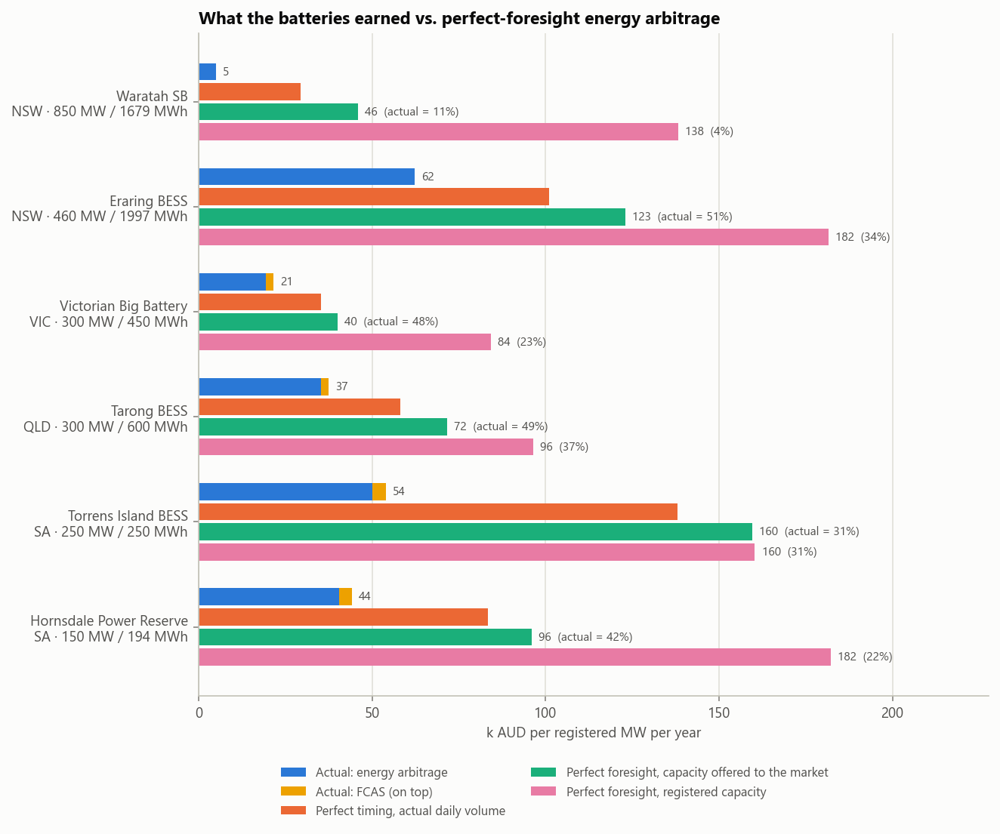
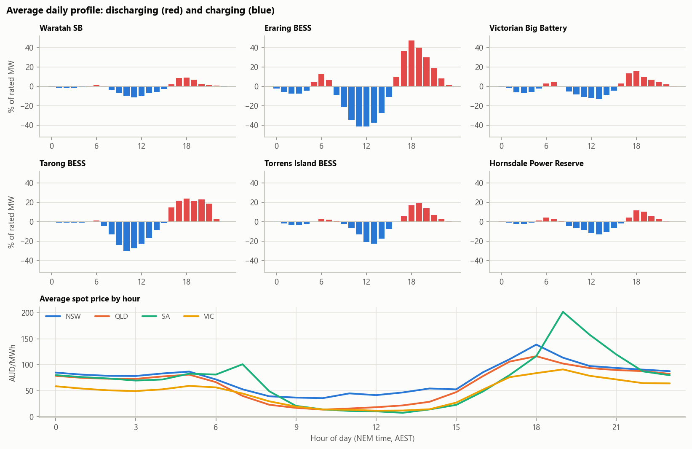
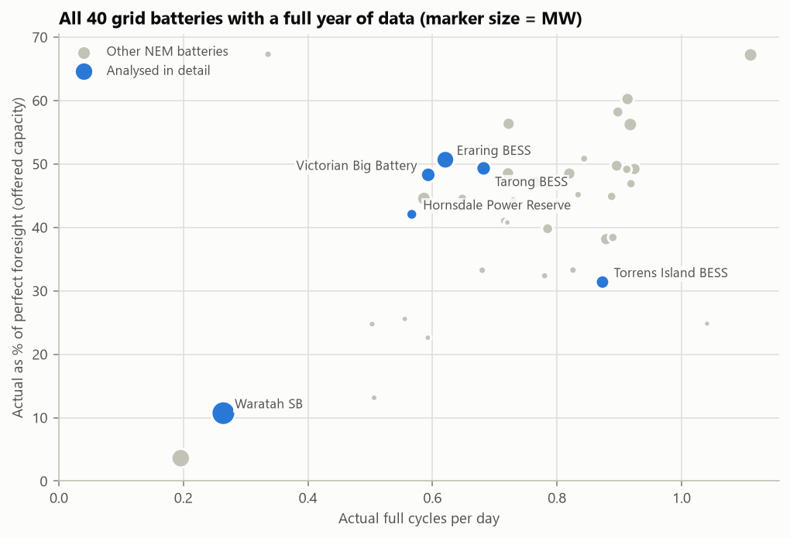
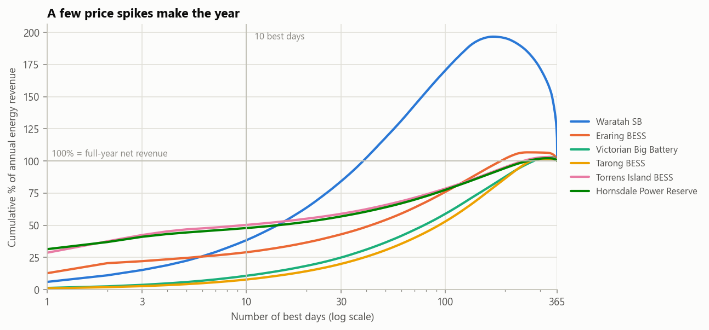
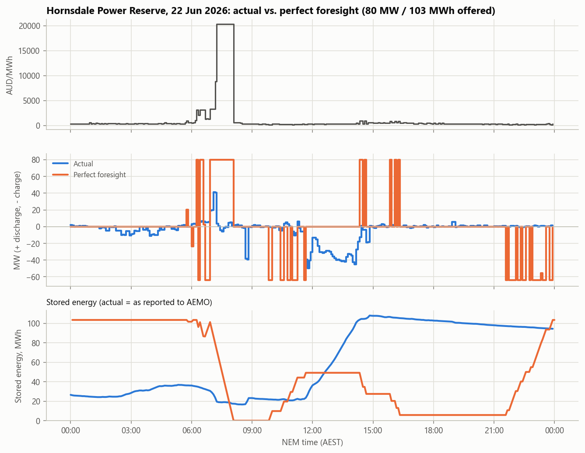

# How Australia's grid batteries actually trade, and what they leave on the table


Australia's National Electricity Market (NEM) publishes 5-minute operational data for every grid-scale battery.
This project reads one year of it (October 2025 to September 2026) straight from AEMO's market data archive and
asks two questions:

1. **How do the batteries really operate?** When do they charge and discharge, how many cycles do they run, what
   prices do they buy and sell at, and how much do they earn from energy arbitrage versus frequency control (FCAS)?
2. **How much do they leave on the table?** Each day is re-optimised with **perfect foresight** of prices (a
   mixed-integer linear program on 288 five-minute intervals). The gap between what a battery earned and what it
   could have earned is then split into capacity it never offered to the market, the volume it cycled, and the
   timing of its trades.

It covers six large batteries in detail (Waratah, Eraring, Victorian Big Battery, Tarong, Torrens Island,
Hornsdale) and every one of the **40 batteries of 20 MW or more** with a full year of data: 6.7 GW and 14.4 GWh.

## Key results (1 Oct 2025 - 30 Sep 2026)



| Battery | Region | MW / MWh | Cycles per day | Avg. sell / buy price (AUD/MWh) | Energy revenue | FCAS revenue | Capacity offered | Perfect foresight, offered capacity | Actual vs. that optimum | Actual vs. perfect timing at same volume |
|---|---|---|---|---|---|---|---|---|---|---|
| Waratah Super Battery | NSW | 850 / 1,679 | 0.26 | 95 / 46 | 4.9 | 0.0 | 41 % | 45.9 | **11 %** | 17 % |
| Eraring BESS | NSW | 460 / 1,997¹ | 0.62 | 112 / 39 | 62.3 | 0.0 | 80 % | 122.9 | **51 %** | 62 % |
| Victorian Big Battery | VIC | 300 / 450 | 0.59 | 87 / 22 | 19.4 | 2.1 | 49 % | 40.1 | **48 %** | 55 % |
| Tarong BESS | QLD | 300 / 600 | 0.68 | 95 / 21 | 35.3 | 2.2 | 81 % | 71.6 | **49 %** | 61 % |
| Torrens Island BESS | SA | 250 / 250 | 0.87 | 173 / 12 | 50.1 | 3.8 | 99 % | 159.6 | **31 %** | 36 % |
| Hornsdale Power Reserve | SA | 150 / 194 | 0.57 | 168 / 13 | 40.4 | 3.7 | 52 % | 96.0 | **42 %** | 48 % |

Revenues are in **thousand AUD per registered MW per year**. "Capacity offered" is the average share of registered
power the operator made available to the energy market (see Method). The last column compares the battery with a
schedule that discharges exactly as much energy each day, but at the best times. ¹ Eraring was extended twice during the year (1,073 to 1,770 to 1,997 MWh); the daily registration is used.

**What the fleet does**

- **One shape fits all.** All six batteries charge in the solar trough (09:00-15:00, when average prices fall to
  10-45 AUD/MWh) and discharges into the evening peak (17:00-21:00), with a small morning discharge around 06:00.
  The median battery sells at the 76th percentile of the day's prices and buys at the 24th: the direction is right,
  but the extremes are mostly missed.
- **Less than one cycle a day.** The median battery ran 0.75 full cycles per day; the perfect-foresight benchmark,
  capped at 1.5, uses most of that cap (median 1.45 cycles per day).
- **FCAS is a side income.** Contingency FCAS prices averaged below 0.4 AUD/MW/h in most mainland markets (the
  Queensland lower services up to 1.6), regulation about 4.6 (raise) and 1.6-1.8 (lower). FCAS earned the 40
  batteries 18 million AUD, **6 % of their combined revenue** (energy arbitrage: 269 million AUD). Only two small
  units (Bulgana, 20 MW, and Bouldercombe, 50 MW) earn a third or more of their income from FCAS.



**What they leave on the table**

- **The median battery earned 45 % of the perfect-foresight energy revenue for the capacity it offered** (inter-
  quartile range 33-49 %) and 38 % against its registered capacity. MW-weighted across the fleet: 40 thousand AUD
  per MW-year actual, 93 thousand with perfect foresight, 131 thousand with all registered capacity.
- **Timing is the larger part of the gap, volume the smaller.** With the same daily discharge volume as in
  reality, perfect timing alone would have reached a median 82 % of the optimum; the batteries' actual timing earned
  a median 55 % of that. Batteries that cycle more capture more (correlation 0.50 between cycles per day and capture
  ratio).
- **Capacity held back explains most of the gap for some of the biggest units.**
  - The **Victorian Big Battery** offered only about 13 % of its 300 MW to the market from November to March (and
    ran 0.35 cycles per day), against 74 % and 0.76 cycles per day in April-October. This matches its System
    Integrity Protection Scheme (SIPS) contract with AEMO, which reserves 250 MW over the summer months.
  - **Waratah** offered 11-22 % of its 850 MW from November to March and 40-71 % from April. Most of the battery is
    contracted to Transgrid as a SIPS "shock absorber" (up to 700 MW / 1,400 MWh), and one of its transformers
    failed in October 2025. Against its registered size it captured 4 %; against what it offered, 11 %. Its ratio of
    discharged to charged energy is only 66 %, presumably because auxiliary and standby losses continue while most
    of the battery sits in reserve.
  - **Hornsdale** never offered more than about 80 of its 150 MW. Part of its capacity has been contracted to the
    South Australian government for system-security services since 2017.
  - **Eraring and Tarong** were still ramping up in October-December 2025 (5 % and 0 % offered in October), and
    **Liddell** (500 MW, not in the table) discharged nothing until January 2026 and ramped up through the year: it
    has the lowest capture of the fleet (4 %).
- **South Australia is spikes.** Almost 30 % of South Australian 5-minute prices were negative (against 26 % in
  Victoria, 14 % in Queensland and 10 % in NSW), and prices hit the 20,300 AUD/MWh cap in 19 intervals. For the
  median SA battery, the **10 best days earned 49 % of the year's energy revenue** (Queensland: 10 %). SA batteries
  sell at the highest average prices (Torrens Island 173 AUD/MWh) but capture the smallest share of the optimum
  (median 35 %), because missing a single spike is expensive.





The curves above 100 % (Waratah, Eraring) mean that the best days earned more than the whole year: on the remaining
days the battery lost money on energy, by charging to cover its standby losses or while commissioning.

### One day: a missed price spike

On 22 June 2026 South Australian prices rose above 1,000 AUD/MWh at 06:15 and sat at the 20,300 AUD/MWh cap for
50 minutes from 07:15 (10 of the year's 19 cap intervals in SA). Hornsdale started the day almost empty (27 MWh
reported, of 194) and offered 80 MW; it sold briefly at about 40 MW and earned 27 thousand AUD that day. With the
same 80 MW / 103 MWh and perfect foresight the battery would have started full, discharged through the spike and
refilled in the evening: 1.5 million AUD, a quarter of Hornsdale's energy revenue for the entire year. Perfect foresight is of course the point: nobody knows a spike is coming at midnight, but
it shows how lopsided the payoff is, and why operators hold energy in reserve.



## Method

### Data

All data come from AEMO's **MMSDM monthly archive** on NEMWeb
(`https://nemweb.com.au/Data_Archive/Wholesale_Electricity/MMSDM/`), public and without registration. For each month
the raw zips are downloaded, filtered to bidirectional units (batteries registered as one unit since the 2024
integrated-storage rules) and cached as small Parquet files; the raw files are then deleted.

| Table | Used for |
|---|---|
| `DISPATCH_UNIT_SCADA` | measured output of every battery, MW, 5-minute |
| `DISPATCHPRICE` | regional energy price (RRP) and the ten FCAS prices, 5-minute |
| `DISPATCHLOAD` | FCAS enablement, the availability offered to the market, reported state of charge |
| `DUDETAIL`, `DUDETAILSUMMARY`, `STATION` | region, registered MW and MWh, registration changes, names |

About 1.9 GB is downloaded for a year (`DISPATCHLOAD` is most of it); the cache is about 125 MB.

### What the batteries did

- **Energy.** `SCADAVALUE` is an instantaneous reading at the start of each dispatch interval (it equals
  `DISPATCHLOAD.INITIALMW`). The energy of an interval is the integral of a straight line between the readings at
  its start and end, split exactly into its discharging and charging parts when the line crosses zero.
- **Revenue.** Energy revenue = regional price x net energy, per 5-minute interval (the NEM settles every 5
  minutes). FCAS revenue = enablement (MW) x regional FCAS price (AUD/MW/h) x 5/60 h for each of the ten services.
- **Cycles** = discharged energy / registered storage capacity valid on that day. **Captured price** = energy-
  weighted average price of discharging or charging; **price percentile** = rank of each interval's price within its
  day.

### The perfect-foresight benchmark

Each calendar day (288 intervals, NEM time = AEST) is solved as a mixed-integer linear program with HiGHS (via
SciPy) that maximises

```
sum_t price_t * dt * (discharge_t - charge_t)  -  cycling_cost * sum_t dt * discharge_t
```

subject to

- energy balance `e_t = e_{t-1} + eta * dt * charge_t - dt * discharge_t / eta`, `eta = sqrt(0.85)`;
- `0 <= e_t <= registered MWh`; the day starts at a level the optimiser picks and must end with at least as much,
  so nothing is borrowed from the next day;
- `charge_t <= charge MW`, `discharge_t <= discharge MW`, and `charge_t / P_c + discharge_t / P_d <= 1` (one
  inverter);
- no charging and discharging in the same interval (binary variables, see below);
- at most **1.5 full cycles per day**; every MWh discharged costs **10 AUD** (cycling/degradation cost).

Three variants per day:

| Benchmark | Capacity | Discharge volume |
|---|---|---|
| Perfect foresight, registered capacity | registered MW and MWh valid that day | up to 1.5 cycles |
| **Perfect foresight, offered capacity** (headline) | registered MW and MWh x (largest `AVAILABILITY` of the day / registered MW) | up to 1.5 cycles |
| Perfect timing at actual volume | as above | at most what the battery really discharged that day |

`AVAILABILITY` is the MW the operator offered to the energy market; for the six batteries analysed in detail the
dispatch target stayed within it in more than 99.9 % of intervals. Scaling by it removes capacity held back for network contracts, outages or commissioning from the benchmark,
so the headline ratio measures trading, not contracts. The ratios multiply:

```
actual / optimum(registered) = actual / timing  x  timing / optimum(offered)  x  optimum(offered) / optimum(registered)
                                 (timing)          (volume)                       (capacity offered)
```

**Binary variables only where needed.** A binary per interval makes the problem slow on days with hours of
negative prices: HiGHS has to sort through thousands of equally good ways to spread charging over near-identical
prices, and a South Australian day could take minutes. But with a positive price, charging and discharging at once
is never optimal (lowering both, keeping the stored energy, earns `price * dt * a * (1 - RTE)` more). With a negative
price, cycling energy through the losses earns `|price| * (1/RTE - 1)` per MWh, which the 10 AUD/MWh cycling cost
outweighs unless the price is below about -57 AUD/MWh. So the model solves the LP first and adds a binary only for
intervals where the LP charges and discharges at once, repeating until none does; that solution is optimal for the
full MILP. For the six batteries in detail, 11 of 2,190 battery-days needed any binary at all. A full run over 40
batteries (14,600 battery-days, three solves each) takes about 5 minutes on a 12-core laptop.

## Limitations

- **Perfect foresight is unattainable.** Operators forecast prices and must also manage the risk of being empty
  when a spike comes, so a capture ratio well below 100 % is expected. The benchmark is an upper bound, not a target.
- **Contracts are invisible.** Cap contracts, SIPS and network-support payments, and retailer hedging are not in
  the data. A battery holding charge to cover a cap contract looks like it is "leaving money on the table" here.
- **Offered capacity is the operator's own declaration.** Lowering `AVAILABILITY` can itself be a trading decision;
  the benchmark scales MW and MWh together, which simplifies contracts that reserve power and energy differently.
- **Simplified settlement.** No marginal loss factors, market fees, FCAS cost recovery or frequency-performance
  payments; FCAS revenue is enablement x clearing price. Energy is from SCADA, not settlement meter data.
- **One efficiency for all.** The benchmark assumes 85 % round-trip efficiency; the median observed ratio of
  discharged to charged energy is 83 %, which also includes auxiliary consumption.
- **Daily horizon.** Each day is optimised separately with a free but self-financed starting level; energy cannot be
  carried over several days, and the reported state of charge is not used, because for several units it reads zero
  or above the registered capacity for long stretches.
- Nominal AUD. Data as published in the MMSDM archive in October 2026.

## Run it

```bash
pip install -e ".[dev]"
pytest -q
python -m nem_battery run --start 2025-10-01 --end 2026-09-30
```

`run` downloads whatever is missing (about 1.9 GB of zips for a year, about 1.5 minutes per month), then writes
`results/` and `docs/img/`. Options: `--units` (batteries analysed in detail, as AEMO DUIDs), `--no-fleet`,
`--rte`, `--deg-cost`, `--cycles`, `--jobs`; `python -m nem_battery run --help` lists them all. `python -m nem_battery
fetch` only downloads.

```
src/nem_battery/
  mms.py         AEMO MMS CSV reader (streaming, filtered) and MMSDM archive downloader
  data.py        monthly Parquet cache, battery registry
  analysis.py    5-minute energy and revenue, summaries, daily profiles, benchmarks
  optimizer.py   perfect-foresight MILP with lazily added binaries
  plots.py       charts
  cli.py         command line interface
tests/           parser, optimiser and analysis tests (no network)
results/         fleet_summary.csv (one row per battery), daily_selected.csv, hourly_profiles.csv,
                 monthly_selected.csv, run.json
```

## License

Code: MIT. Data: Australian Energy Market Operator (AEMO), MMSDM data archive, used under
[AEMO's copyright permissions](https://www.aemo.com.au/privacy-and-legal-notices/copyright-permissions). Results are
derived from AEMO material; AEMO is not responsible for this analysis.

Context on the SIPS contracts and Waratah's transformer: AEMO media release on the Victorian Big Battery SIPS
service (December 2021), Energy-Storage.news and RenewEconomy reporting on Waratah Super Battery (2025-2026) and on
Hornsdale's reserve-capacity contract with the South Australian government.
